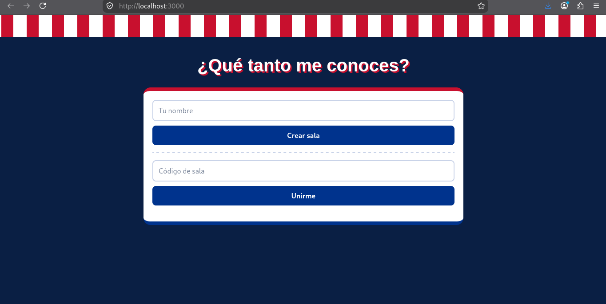
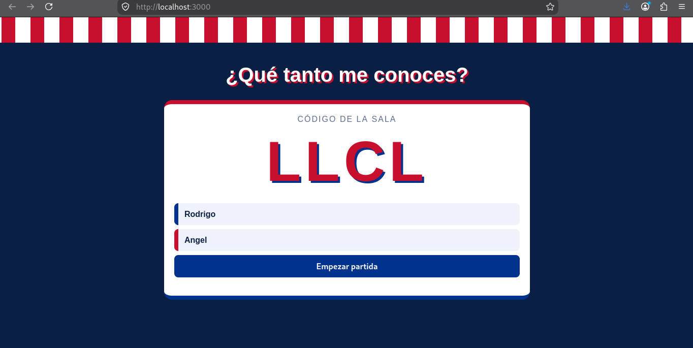
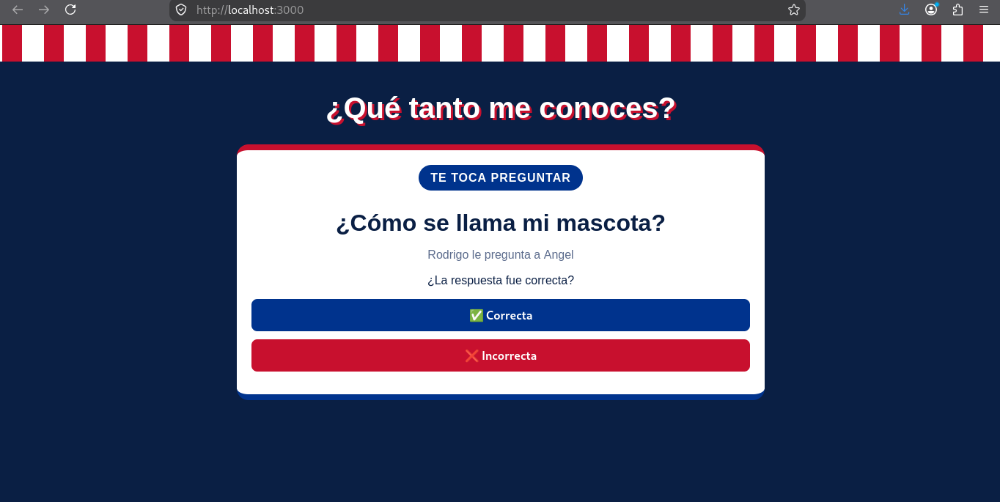
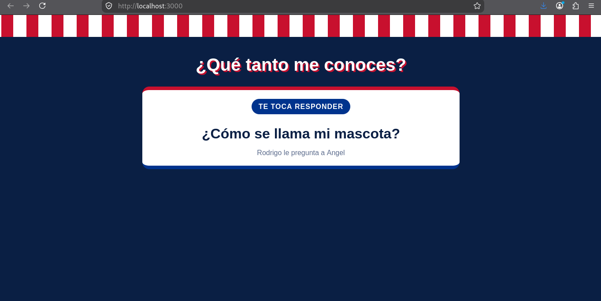
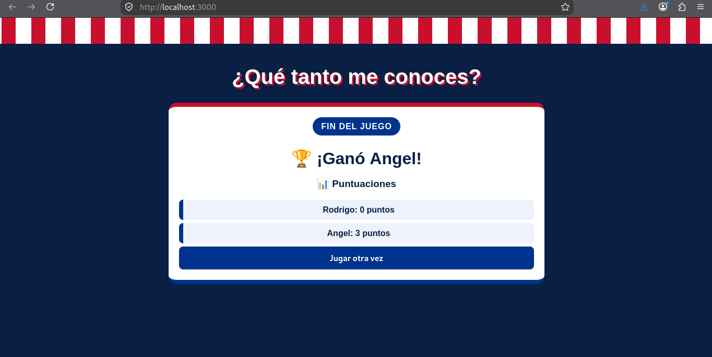

# ¿Qué tanto me conoces? 🎯

Juego multijugador en tiempo real para descubrir qué tanto conoces a tus amigos, pareja o familia. Cada quien juega desde su propio celular: se escanea o se abre un link, se mete el código de la sala y listo. Es una idea parecida a Kahoot, pero con preguntas personales.

## Capturas

| Inicio | Sala de espera |
|:---:|:---:|
|  |  |

| Te toca preguntar | Te toca responder |
|:---:|:---:|
|  |  |

| Pantalla del ganador |
|:---:|
|  |

## Cómo se juega

1. Una persona crea una sala y recibe un **código de 4 letras**.
2. Los demás entran con ese código desde su celular o compu.
3. El anfitrión empieza la partida (mínimo 2 jugadores).
4. En cada ronda el servidor elige al azar **quién pregunta** y **quién responde**.
5. Quien pregunta conoce la respuesta: si el otro acierta, confirma con **Correcta** y el que respondió suma un punto.
6. Después de cada ronda se muestra la tabla de puntuaciones y a los pocos segundos empieza la siguiente.
7. Gana el primero en llegar a la meta de puntos.

## Funcionalidades

- Salas con código único, varias partidas al mismo tiempo sin mezclarse.
- Lista de jugadores que se actualiza **en vivo** para todos.
- Elección aleatoria de quién pregunta y quién responde.
- Las preguntas no se repiten para quien pregunta (si ya la usó, no le vuelve a salir).
- Solo quien pregunta puede validar la respuesta, y solo el anfitrión puede empezar la partida.
- Si alguien se desconecta, el juego sigue: se cancela la ronda y se inicia otra, y el rol de anfitrión pasa al siguiente jugador.
- No se puede entrar a una partida ya empezada.
- Opción de "Jugar otra vez" con puntos reiniciados.
- Diseño responsivo, pensado primero para celular.

## Cómo correrlo en tu compu

Necesitas tener [Node.js](https://nodejs.org) instalado.

```bash
git clone https://github.com/rodri619/que-tanto-me-conoces.git
cd que-tanto-me-conoces
npm install
npm start
```

Abre `http://localhost:3000` en tu navegador.

### Jugar con amigos en la misma red WiFi

Averigua la IP de tu compu (por ejemplo con `hostname -I` en Linux) y pide a los demás que abran `http://TU-IP:3000` en su celular.

### Jugar con amigos por internet

Puedes abrir un túnel temporal con [Cloudflare Tunnel](https://developers.cloudflare.com/cloudflare-one/connections/connect-networks/), sin crear cuenta:

```bash
cloudflared tunnel --url http://localhost:3000
```

Te dará un link público que puedes compartir.

## Estructura del proyecto

```
.
├── server.js        # Servidor y lógica del juego
├── package.json
├── public/
│   ├── index.html   # Pantallas del juego
│   ├── style.css    # Estilos
│   └── client.js    # Lógica del navegador
└── screenshots/     # Capturas para este README
```
## Limitaciones conocidas y mejoras futuras

- El estado vive en memoria: si el servidor se reinicia, las salas se pierden.
- Si alguien recarga la página, pierde su lugar (la conexión cambia de identificador). Faltaría implementar reconexión.
- Ideas pendientes: categorías de preguntas, sonidos y una cuenta regresiva entre rondas.

## Autor

**Rodrigo Jiménez** — [@rodri619](https://github.com/rodri619)